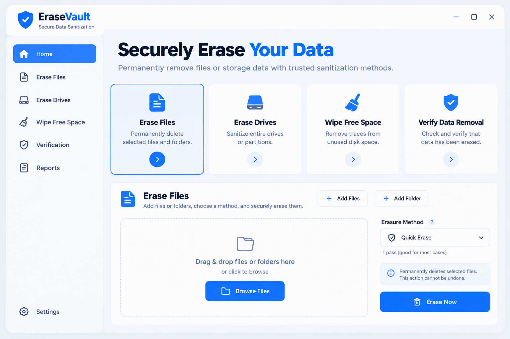

# 🛡️ EraseVault — Secure Data Sanitization


-10B981?style=flat-square)


**EraseVault** is a Windows desktop application built with **Python** and **PySide6** for securely erasing files, folders, USB drives, external/phone storage, partitions, and unused disk space. It supports industry-standard multi-pass sanitization methods, protects critical system locations from accidental erasure, automatically verifies results, and generates tamper-evident **SHA-256** integrity reports.

## ✨ Interface Preview



## 🚀 Key Features

### 1. Secure File & Folder Erasure
Supports automatic target-aware method selection (`Auto`) alongside six cryptographic and legacy data sanitization standards:

| Sanitization Method | Passes | Pattern / Standard | Verification & Flushing |
| :--- | :--- | :--- | :--- |
| **Auto (Smart Selection)** | `Adaptive` | Automatically selects optimal method by storage type | Post-pass verification + `os.fsync()` |
| **Quick Erase** | `1-Pass` | Zero-Fill (`NIST SP 800-88 Clear`) | `1 MB` aligned buffers + `os.fsync()` |
| **NIST SP 800-88 CSPRNG Clear** | `1-Pass` | Cryptographic Random + Read Verify | Full pass verification + `os.fsync()` |
| **US DoD 5220.22-M** | `3-Pass` | Fixed, Complement, CSPRNG Random | Pass-level flush + tail verification |
| **US DoD 5220.22-M ECE** | `7-Pass` | Extended DoD Multi-Pattern Overwrite | Pass-level flush + tail verification |
| **Bruce Schneier** | `7-Pass` | `0xFF`, `0x00`, + 5 CSPRNG Passes | Pass-level flush + tail verification |
| **Peter Gutmann** | `35-Pass` | Full 35-Pass Legacy Pattern Sequence | Pass-level flush + tail verification |

- **Cluster Slack Padding**: Pads file tails to `4 KB` boundaries using `1 MB` aligned buffers and `os.fsync()` after each pass.
- **Metadata Obfuscation**: Resets timestamps and executes multi-stage random renaming before truncating and unlinking files.
- **Symlink & Junction Safety**: Safely unlinks symbolic links and NTFS junctions without traversing external target directories.

### 2. Drive, Partition & USB/Phone Storage Sanitization
- **Hardware & Volume Discovery**: Detects logical volumes, physical disks, partitions, removable USB drives, and connected phone storage via Windows Win32 APIs, PowerShell/WMI, and filesystem utilities.
- **System-Drive Lockout**: Strictly protects the active Windows boot/system drives, critical OS directories, and the application directory from accidental erasure.
- **Destructive Action Guardrail**: Requires explicit manual confirmation (`TYPE CONFIRM TO ERASE`) before executing sanitization on eligible non-system volumes, USB drives, or raw disk images.

### 3. Free-Space Wiping & SSD TRIM
- **Unallocated Space Sanitization**: Overwrites residual data in unallocated disk space using an isolated temporary container with configurable reserve limits.
- **Automatic Interruption Cleanup**: Cleans up temporary wipe containers automatically if an operation is cancelled or interrupted.
- **Windows & SSD Integration**: Provides optional `cipher.exe /w:` integration and supports SSD TRIM via `Optimize-Volume -ReTrim`.

### 4. Automated Erasure Verification
- **Path & Residual Removal Check**: Verifies that targeted files and directories have been completely removed.
- **Statistical Entropy Analysis**: Calculates **Shannon entropy** and **zero-byte ratios** across sampled regions.
- **File Signature Carving Scan**: Scans sampled sectors for residual magic bytes across common formats (`PDF`, `ZIP`, `PNG`, `JPEG`, `SQLite`, `PEM`, `7z`, `RAR`, `PE`, and `ELF`).
- **Hardware-Aware Caveats**: Accounts for SSD, NVMe, and USB flash wear-leveling limitations, reporting flash media results with appropriate wear-leveling context rather than overclaiming physical NAND cell erasure.

### 5. Audit History & Tamper-Evident Reports
- **Local Audit Ledger**: Stores operation history locally in **SQLite**.
- **Multi-Format Certificates**: Generates printable **HTML sanitization certificates**, **JSON audit reports**, and plain-text logs.
- **SHA-256 Integrity Digest**: Embeds SHA-256 digests in generated reports to detect post-export modifications.

## 📂 Project Structure

```text
EraseVault/
├── main.py                      # Application entry point
├── EraseVault.pyw               # Windowed (console-free) Windows launcher
├── run_erasevault.bat           # One-click Windows batch launcher
├── requirements.txt             # Python dependencies (PySide6, Pillow)
├── .gitignore                   # Git ignore rules for Python and build artifacts
├── LICENSE                      # MIT License
├── README.md                    # Project documentation
├── assets/
│   └── icons/                   # UI icons for Light and Dark themes
├── docs/
│   └── screenshots/             # UI preview screenshot for documentation
├── erasevault/
│   ├── core/
│   │   ├── models.py            # Core data structures and sanitization enums
│   │   ├── storage.py           # Win32 / WMI / PowerShell drive & volume detection
│   │   ├── validator.py         # System-drive & critical path protection rules
│   │   ├── sanitizer.py         # Multi-pass file, drive, and free-space wipe engine
│   │   ├── verifier.py          # Entropy, zero-ratio, and file signature verifier
│   │   ├── history.py           # SQLite history persistence manager
│   │   ├── reports.py           # HTML, JSON, and TXT report generator with SHA-256 digests
│   │   └── settings.py          # Application settings persistence
│   └── ui/
│       ├── main_window.py       # Frameless main window, sidebar navigation & theme toggle
│       ├── components.py        # Custom reusable Qt widgets and cards
│       ├── panels.py            # Workspace panels (Home, Files, Drives, Free Space, Reports)
│       ├── dialogs.py           # Confirmation dialogs ("TYPE CONFIRM TO ERASE") & modals
│       ├── workers.py           # Background QThread workers for non-blocking execution
│       ├── assets.py            # Cached icon & pixmap loader
│       ├── styles.py            # Light & Dark mode Qt stylesheets
│       └── qt_compat.py         # PySide6 compatibility layer
└── tests/
    └── test_erasevault.py       # Automated unit & integration test suite
```

## ⚙️ Requirements

- **OS**: Windows 10 / Windows 11
- **Python**: Python 3.9+
- **Packages**: `PySide6`, `Pillow`

## 🛠️ Installation & Usage

1. **Clone the repository**:
   ```bash
   git clone https://github.com/ishaqsec/EraseVault.git
   cd EraseVault
   ```

2. **Install dependencies**:
   ```bash
   pip install -r requirements.txt
   ```

3. **Launch EraseVault**:
   ```bash
   python main.py
   ```

4. **Run automated tests**:
   ```bash
   python -m unittest discover -s tests -v
   ```

## ⚠️ Important Notes

- **Destructive Operations**: EraseVault permanently overwrites and removes targeted data. Always review selected targets carefully before confirming.
- **System-Drive Protection**: Active boot and system partitions are blocked automatically to prevent accidental OS data loss.
- **SSD & Flash Storage**: Software-based overwriting cannot guarantee physical erasure of every remapped SSD or flash-memory block due to controller wear-leveling.
- **Backups**: Always maintain backups of important files before running sanitization workflows.

## 👤 Author

**Muhammad Ishaq**
- GitHub: [@ishaqsec](https://github.com/ishaqsec)
- Version: `v1.0.0`
- License: [MIT License](LICENSE)
